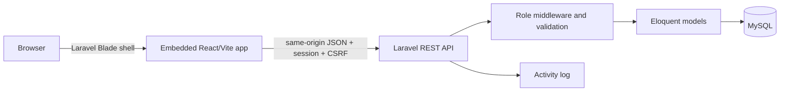

# Riverbend Clinic Appointment & Operations Dashboard

A portfolio-quality, responsive clinic operations application for coordinating fictional patients, doctors, appointments, issues, users, and daily workflow. It is an educational demonstration only—not a medical record system and not suitable for real clinical use.

## Problem and solution

Small clinics often coordinate schedules, waiting patients, staff access, and operational issues across disconnected tools. Riverbend provides one role-aware workspace with an at-a-glance dashboard and focused workflows for administrators, receptionists, and doctors.

## Main features

- Laravel session authentication with Sanctum CSRF protection; no public registration
- Admin, receptionist, and doctor authorization on both API and UI routes
- Patient and doctor management with search, validation, pagination, and safe delete rules
- Daily appointment schedule, filtering, status updates, and overlap prevention
- Live dashboard counts, status distribution, recent appointments, and issues
- Issue reporting with admin triage fields and personal visibility for staff
- Admin-only user management and activity log
- Loading, empty, validation, success, API-error, unauthorized, and not-found states
- Responsive, keyboard-friendly interface from 360 px through desktop sizes
- Entirely fictional seed data

## Roles

| Role | Access |
|---|---|
| Admin | Full dashboard, users, doctors, patients, appointments, all issues, activity log |
| Receptionist | Dashboard, patients, appointments, doctor availability, own issues |
| Doctor | Own appointments and status/notes, doctor directory, own issues |

## Technology

- Frontend: React 19, JavaScript, React Router, Vite, semantic HTML, plain CSS
- Backend: PHP 8.3, Laravel 8.6 application skeleton / Laravel 8 framework, Sanctum REST API
- Database: MySQL 8 / Wampserver (SQLite in automated tests)

> The originally requested early `laravel/laravel:^8.2` skeleton accepts PHP 7.x only. This repository uses the PHP 8-compatible Laravel 8.6 skeleton while remaining on the requested Laravel 8 framework line.

## Architecture



Detailed diagrams: [architecture](docs/ARCHITECTURE.md), [ERD](docs/ERD.md), and [API reference](docs/API.md).

## Folder structure

```text
app/            Laravel models, middleware, and REST controllers
database/       Migrations, factories, and fictional seed data
resources/js/   Embedded React application, pages, components, and API client
resources/css/  Plain CSS design system and responsive layout
resources/views Laravel Blade SPA shell
routes/         Web fallback and REST API routes
tests/          Backend feature and unit tests
docs/           API, architecture, ERD, and AI-assistance documentation
```

## Prerequisites

- PHP 8.1+ with `pdo_mysql`, `mbstring`, `openssl`, and standard Laravel extensions
- Composer 2
- Node.js 20+ and npm
- MySQL via Wampserver

## Installation

```powershell
git clone <repository-url>
cd "Clinic Appointment & Operations Dashboard"

composer install
Copy-Item .env.example .env
php artisan key:generate
npm install
```

Create a MySQL database named `clinic_operations` in phpMyAdmin or MySQL, then set the root `.env` values:

```dotenv
DB_CONNECTION=mysql
DB_HOST=127.0.0.1
DB_PORT=3306
DB_DATABASE=clinic_operations
DB_USERNAME=root
DB_PASSWORD=
SESSION_DOMAIN=localhost
SANCTUM_STATEFUL_DOMAINS=localhost:8000,127.0.0.1:8000
```

Initialize fictional data:

```powershell
php artisan migrate --seed
```

## Run locally

Use two terminals from the same Laravel project root:

```powershell
php artisan serve
```

```powershell
npm run dev
```

Open `http://localhost:8000`. Laravel serves both the page and API. During development, Vite watches the React source and recompiles it into `public/build`; refresh the browser after a source change.

## Fictional demo accounts

All accounts use password `ClinicDemo!2026`.

| Role | Email |
|---|---|
| Admin | `admin@riverbend.test` |
| Receptionist | `reception@riverbend.test` |
| Doctor | `doctor@riverbend.test` |

These credentials are for local demonstration only.

## Checks and builds

```powershell
php artisan test
php artisan route:list --path=api
npm run lint
npm run build
```

Backend tests use an in-memory SQLite database. For a clean local MySQL rebuild use `php artisan migrate:fresh --seed` only when discarding the current local demo data is intended.

## Screenshots

Add verified screenshots to `docs/screenshots/` after running the application against local MySQL. No screenshot or Lighthouse score is claimed in this repository because browser-based measurement was not performed during the automated build.

## Security and privacy

- No real personal or medical data is included or expected.
- Passwords are hashed by Laravel; session IDs and passwords are never logged.
- All writes are server-validated and all protected endpoints require authentication.
- Authorization is enforced by role middleware and controller-level record scoping.
- Appointment overlap detection executes server-side.
- Secrets belong only in ignored `.env` files; `.env.example` contains safe placeholders.

Laravel 8 is end-of-life and should not be chosen for a new production clinical system. Upgrade to a supported Laravel release before any internet-facing deployment.

## Known limitations

- Educational MVP only; no clinical notes, billing, notifications, file uploads, audit export, or regulatory compliance claims.
- Appointments use local clinic time and a daily list rather than a full recurrence/calendar engine.
- Issue comments/history and automated password-reset email are outside the local-demo scope; an admin can set a new password.
- Doctor availability is a status flag, not a recurring availability-rule engine.
- MySQL service startup and browser Lighthouse testing depend on the local Wamp environment and were not automated.

## Future improvements

- Upgrade Laravel, PHP, and dependency baselines
- Add recurring availability, holidays, and multi-location scheduling
- Add email/SMS reminders through a queued provider
- Add Playwright/Vitest browser workflows and automated accessibility audits
- Add immutable audit exports, backups, retention controls, and formal threat modeling

## AI-assisted development

See [AI_ASSISTED_DEVELOPMENT.md](docs/AI_ASSISTED_DEVELOPMENT.md). Generated work was reviewed through automated backend tests, route inspection, frontend linting/builds, and manual code review; the project does not claim every line was manually authored.
