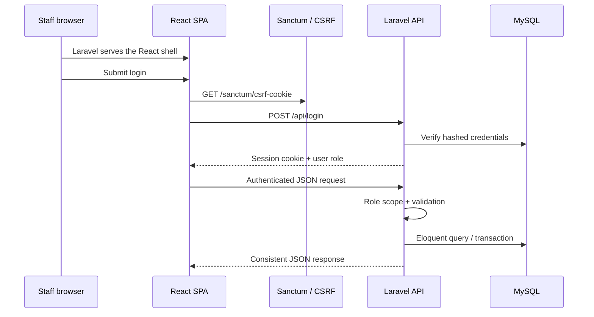

# Architecture

This is one Laravel application with React embedded as its primary interface under `resources/js`. Laravel serves the Blade shell and owns identity, authorization, validation, business rules, persistence, and JSON error semantics. Vite develops and compiles the React interface into `public/build`.

Key decisions:

- First-party cookie sessions instead of browser token storage.
- A single Laravel-root structure matches the course workflow while keeping React organized into pages, components, context, and API modules.
- Backend authorization remains authoritative; frontend guards improve navigation but are not security controls.
- Controllers keep the MVP’s query logic visible and focused. A service layer is avoided where it would only add indirection.
- Appointment overlap uses the standard interval predicate `existing.start < new.end AND existing.end > new.start`, excluding cancelled/no-show records.
- Route-level lazy loading keeps non-critical page code out of the initial bundle.
