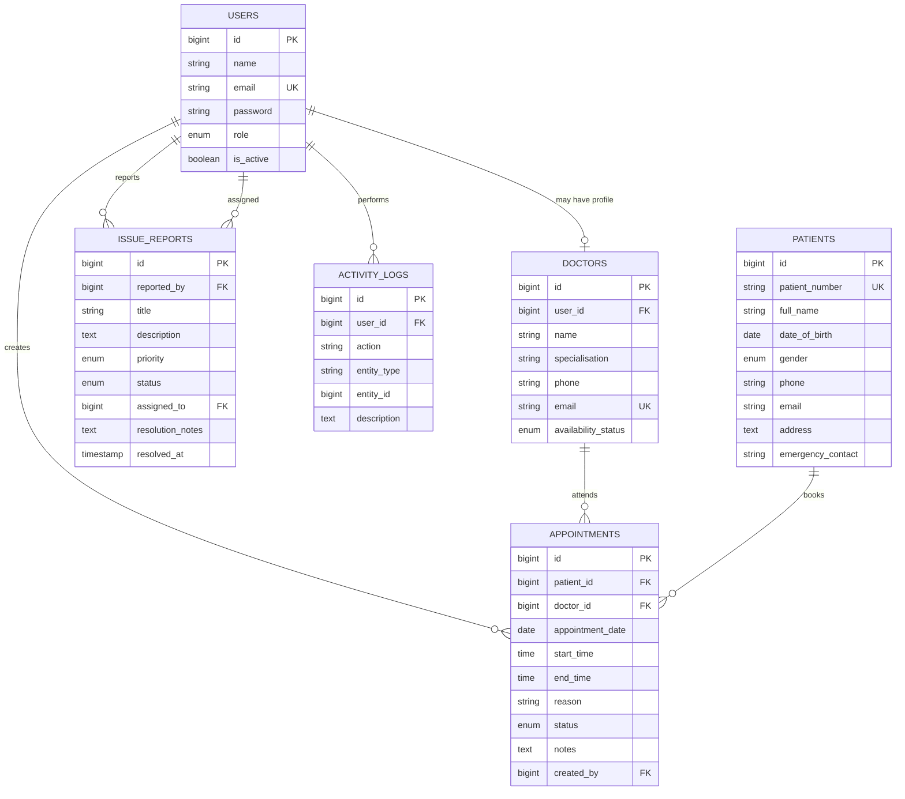

# Database ERD

Appointments and historical records use restrictive deletes. Optional user/profile and assignee references become null when the related account is removed. Search and filter columns are indexed.
